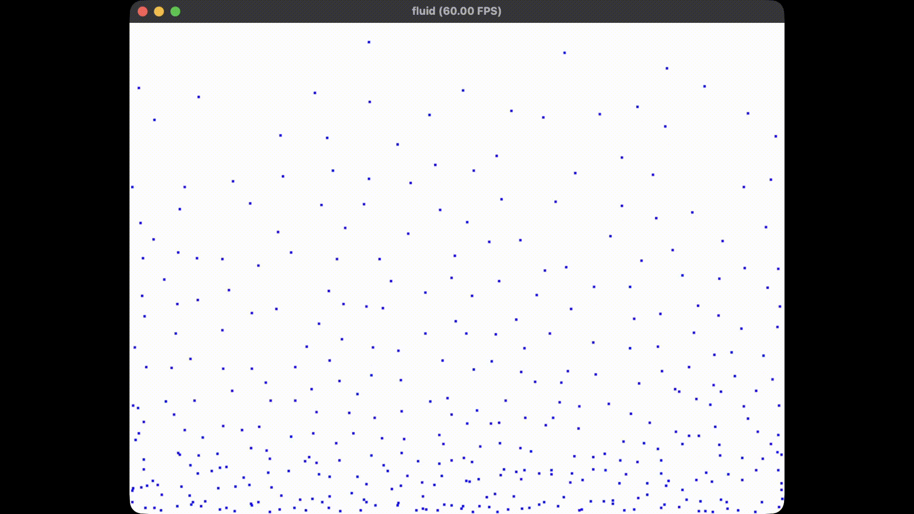

# Kai's Fluid Simulator

Wrote this to demonstrate my ability to write GPU-level fluid simulations. 
It's in Python (because that's what I'm best at), but the functions I wrote are written specifically so they can be compiled to GPU instructions.

